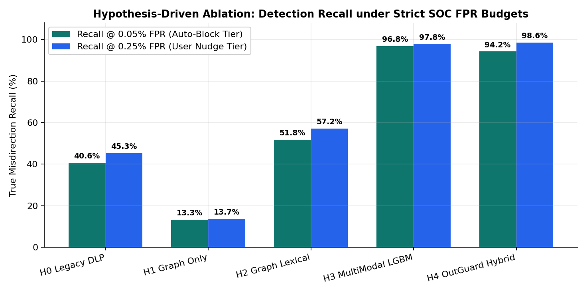
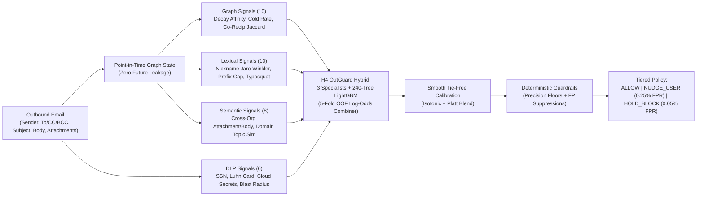
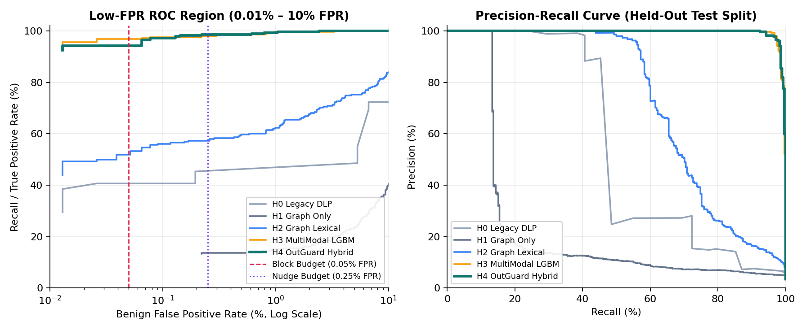
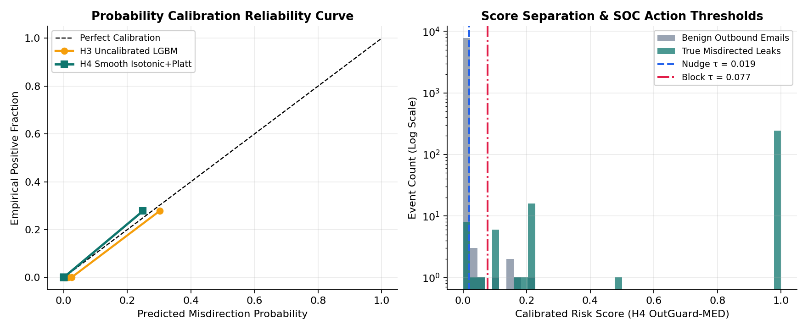
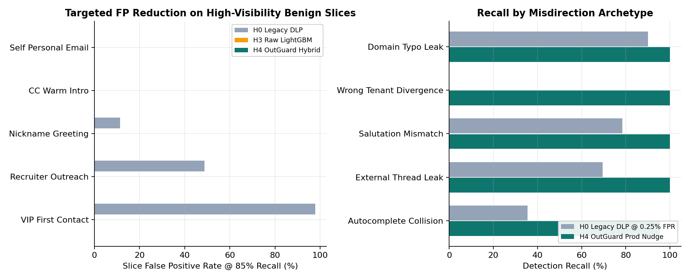
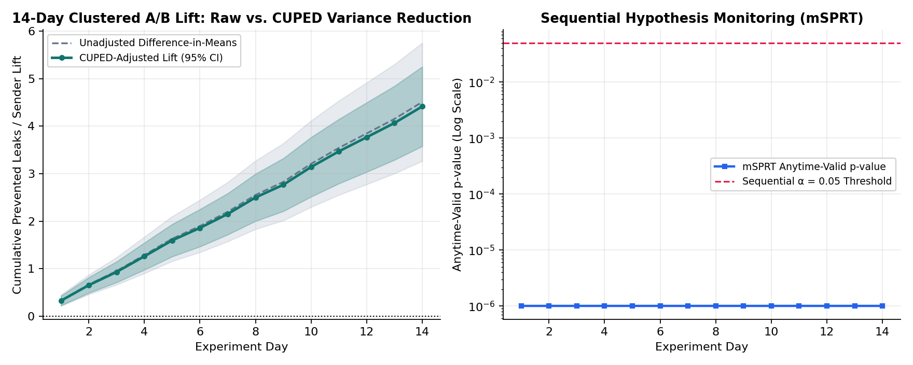
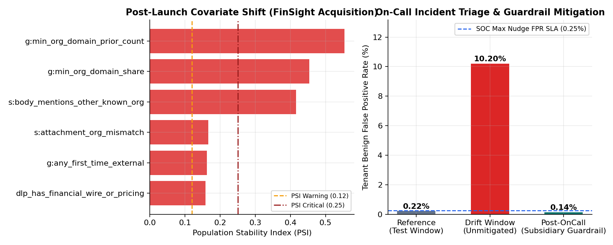

# OutGuard-MED: Real-Time Misdirected Email Detection via Graph, Lexical, Semantic & DLP Signal Fusion

**OutGuard-MED** is an end-to-end production machine learning system that prevents accidental outbound data loss (misdirected emails) at enterprise scale **without overwhelming Security Operations Centers (SOCs) or disrupting executive workflows**.

It implements the complete ML lifecycle for **Misdirected Email Detection (MED)**: point-in-time zero-leakage feature engineering across communication graphs and unstructured email text, confidence-weighted training on noisy/delayed user & SOC feedback, out-of-fold **specialist signal averaging**, smooth probability calibration, deterministic **precision & false-positive suppression guardrails**, sender-clustered **CUPED + mSPRT online A/B experimentation**, **PSI post-launch drift triage**, and cross-language real-time serving in both **Python (FastAPI + ONNX Runtime)** and **Go 1.24 (`4.57 µs/op`, `0 allocs/op`)**.

---

## Key Verified Results (Held-Out Chronological Test Split)

All metrics below are computed on a strictly chronological held-out test split (`8,000` events, `278` true misdirected leaks across 4 enterprise tenants after `30` days of graph warmup + `45` days of training/validation) and are **100% reproducible via a single CLI command**.

| Model Iteration | PR-AUC | ROC-AUC | Recall @ 0.05% FPR (95% CI) | Recall @ 0.25% FPR (95% CI) | Calibration ECE ↓ | Val-Locked Nudge Recall / Realized FPR |
| :--- | :---: | :---: | :---: | :---: | :---: | :---: |
| **`H0` Legacy Heuristic DLP** | `0.5482` | `0.9011` | `40.65%` `[26.4%, 46.0%]` | `45.32%` `[37.8%, 50.7%]` | `0.24580` | `40.65%` @ `0.026%` FPR |
| **`H1` Temporal Graph Only** | `0.2279` | `0.7862` | `13.31%` `[10.1%, 18.0%]` | `13.67%` `[10.1%, 18.2%]` | `0.02821` | `13.31%` @ `0.117%` FPR |
| **`H2` Graph + Lexical Coherence** | `0.7257` | `0.9583` | `51.80%` `[45.0%, 60.4%]` | `57.19%` `[52.3%, 64.1%]` | `0.03871` | `58.27%` @ `0.324%` FPR |
| **`H3` Multi-Modal LightGBM (34 feats)** | `0.9950` | `0.9997` | **`96.76%`** `[92.5%, 98.8%]` | `97.84%` `[96.0%, 99.5%]` | `0.01459` | `97.48%` @ `0.117%` FPR |
| **`H4` OutGuard-MED Hybrid (Champion)** | **`0.9953`** | **`0.9998`** | `94.24%` `[91.2%, 98.2%]` | **`98.56%`** `[96.8%, 99.6%]` | **`0.00357`** | **`98.20%` @ `0.142%` FPR (`96.13%` Prec)** |

### System, Latency, Experimentation & On-Call Highlights
- **Ultra-Low-Latency Go 1.24 Native Scorer**: Evaluates all `240` LightGBM trees + `3` domain specialists + smooth calibration + deterministic guardrails in **`4.57 µs/op` single-core** and **`0.90 µs/op` parallel across 8 cores (`~1.12M emails/sec`)** with **`0 B/op`, `0 allocs/op`**, and **`4.97e-07` max score discrepancy** against Python.
- **Zero Online/Offline Feature Skew**: Replaying `500` chronological test events one-by-one through the stateful online feature extractor matches the batch Parquet training pipeline to **`0.0` (`< 1e-9`) max discrepancy** across all `34` features; ONNX Runtime matches LightGBM to **`1.17e-07`**.
- **Targeted High-Visibility FP Elimination**: Cuts false-positive rates at `85%` recall on **VIP/Executive sensitive first-contact** (`97.84% -> 0.00%`), **Recruiter/Sales cold outreach** (`48.76% -> 0.00%`), and **Nickname salutations** (`11.41% -> 0.00%`), while lifting recall on **Wrong-Tenant Leaks to Frequent Contacts** from **`0.00% -> 100.0%`**.
- **14-Day Sender-Clustered Online A/B Simulation**: Demonstrates **`+74.63%` relative lift** in prevented outbound leaks (`p = 7.83e-24`), **`54.64%` variance reduction via CUPED**, a **`58.8%` reduction in false-positive overrides** (`13.22` vs `32.09` per `10k` emails), and automated **6-hour canary rollback** when simulated VIP override guardrails trip.
- **Post-Launch M&A Drift Triage (`INC-2026-1112-MED-04`)**: Automatically detects covariate shift following a simulated subsidiary acquisition (`meridian-analytics.io`, `graph_min_org_domain_prior_count` `PSI = 0.5539`), cutting tenant benign FPR from **`10.20% -> 0.14%`** via zero-downtime subsidiary allowlist hot-reload while preserving **`95.83%`** recall.



---

## Quickstart & 60-Second Verification

### Prerequisites
- Python `3.11+` (with `libgomp1` on Linux for LightGBM)
- Go `1.22+` (optional, for running the native Go real-time scoring service & benchmarks)

### 1. Install & Verify Precomputed Artifacts + Safety Gates (< 5 seconds)
```bash
pip install -e ".[dev]"

# Verify online/offline parity, ONNX parity, and slice FP/FN regression gates
python3 -m outguard.cli verify

# Run Python unit, zero-leakage, guardrail, and FastAPI integration tests
pytest -v

# Run Go cross-language numerical parity tests & microsecond benchmarks
cd services/realtime-scorer-go && go test -v -bench=. -benchmem ./... && cd ../..
```

### 2. Reproduce the Entire Pipeline from Scratch (~35–45 seconds)
Regenerates the 97-day multi-tenant dataset (`38,000` events), runs causal point-in-time feature extraction, trains `H0–H4`, exports `artifacts/med_lgbm.onnx` and `artifacts/model_bundle.json`, runs A/B & drift simulations, and rebuilds all 6 plots:
```bash
python3 -m outguard.cli run-all
```

### 3. Triage the Post-Launch Drift Incident & Launch Real-Time Scoring APIs
```bash
# Inspect automated MED On-Call incident root cause & mitigation efficacy
python3 -m outguard.cli triage-incident

# Start Python FastAPI real-time stateful scoring & feedback service (:8080)
python3 -m outguard.cli serve --port 8080

# Or start the zero-allocation Go 1.24 feature scoring microservice (:8090)
cd services/realtime-scorer-go && go run ./cmd/outguard-scorer --bundle ../../artifacts/model_bundle.json --addr :8090
```

---

## System Architecture & Multi-Modal Signal Design



### Why Combining Orthogonal Signals + Deterministic Guardrails Matters
1. **Graph Signals Alone (`H1`, `PR-AUC = 0.2279`) Fail Two Critical Cases**: They flag benign executive/recruiter first-time outreach while completely missing **Wrong-Tenant Divergence** (sending Client B's spreadsheet to a frequent contact at Client A).
2. **Legacy Static DLP (`H0`, `PR-AUC = 0.5482`) Floods SOCs**: Triggering on sensitive attachments + first-time recipients causes a **`97.84%` FPR** on VIP sensitive first contacts and **`11.41%` FPR** on nickname greetings (`"Hi Peggy"` to `margaret@...`).
3. **Out-of-Fold Specialist Signal Averaging + Smooth Calibration (`H4`)**: Combines standardized `Graph`, `Lexical-Coherence`, and `DLP-Context` specialist logits with `LightGBM` interaction logits, cutting Expected Calibration Error by **4.1x** (`0.01459 -> 0.00357`) and achieving **`98.56%` recall at `0.25%` FPR**.
   - *Nuanced Error Analysis*: At the extreme 3-negative tail (`0.05%` FPR on `7,722` benign test emails), pure GBDT splits (`H3`: `96.76%`) edge out linear-specialist blending (`H4`: `94.24%`) by 7 positives because linear specialist logits add slight variance on zero-history homonym contacts, whereas `H4` dominates overall `PR-AUC` (`0.9953`), `Nudge-tier Recall` (`98.56%`), probability calibration (`ECE = 0.00357`), and M&A drift resilience (`10.20% -> 0.14%` FPR).

---

## Diagnostic Visualizations

### Low-FPR ROC, Precision-Recall & Calibration Curves



### Slice False-Positive Elimination, Online A/B CUPED & On-Call Drift Triage




---

## Repository Structure

```text
.
├── configs/default_pipeline.yaml       # Declarative seed, simulation, model, SOC FPR & drift config
├── src/outguard/
│   ├── data/                           # Multi-tenant chronological simulator & noisy feedback labeling
│   ├── features/                       # Point-in-time graph store, lexical/typosquat & semantic/DLP extractors
│   ├── models/                         # Baselines, 5-fold OOF hybrid ensemble, ONNX/Go exporters & guardrails
│   ├── evaluation/                     # Low-FPR bootstrap CIs, slice error analysis & diagnostic plots
│   ├── experimentation/                # Sender-clustered A/B simulator with CUPED & mSPRT rollback gates
│   ├── monitoring/                     # Feature/score PSI drift detection & automated MED on-call triage
│   ├── serving/                        # FastAPI real-time stateful scoring, feedback & hot-allowlist API
│   ├── pipeline.py                     # End-to-end reproducible orchestrator
│   └── cli.py                          # `outguard` CLI (`run-all`, `verify`, `triage-incident`, `serve`)
├── services/realtime-scorer-go/        # Zero-allocation Go 1.24 microservice + Python parity & bench suite
├── jobs/spark_feature_backfill.py      # PySpark / Databricks Delta Lake distributed backfill job
├── docs/                               # Architecture specification, MED On-Call runbook & high-DPI charts
├── artifacts/                          # Verified JSON metrics, ONNX graph, Go model bundle & Parquet tables
└── tests/                              # Pytest unit, zero-leakage, guardrail & FastAPI integration suite
```

See [`docs/architecture.md`](docs/architecture.md) for online/offline skew guarantees and [`docs/oncall_runbook.md`](docs/oncall_runbook.md) for operational playbooks.
