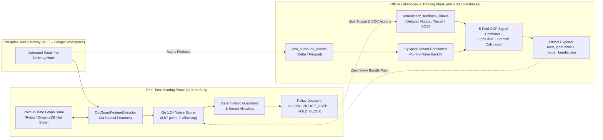

# OutGuard-MED System Architecture & Pipeline Topology

## 1. End-to-End Online vs. Offline Data & Scoring Architecture

## 2. Offline vs. Online Skew Prevention Guarantees

A classic failure mode in Misdirected Email Detection is **future communication leakage**: computing historical sender-recipient frequency across an entire training window makes every misdirected email whose recipient *subsequently* replied look like an established contact during training, while appearing as a 0-count contact online.

OutGuard-MED eliminates this skew via three invariants:
1. **Strict Read-Before-Write Causality**: For any chronological event $e_t$, `OutGuardFeatureExtractor.extract_single_event` reads `PointInTimeGraphState` at timestamp $t$ *before* `state.update(e_t)` mutates edge counts, exponential recency weights ($w \leftarrow w \cdot 2^{-\Delta t / \tau_{1/2}} + 1$), co-recipient Jaccard tables, or domain topic profiles.
2. **Blocked-Event State Isolation**: In online serving (`src/outguard/serving/app.py`), emails blocked by `HOLD_BLOCK` do **not** increment trusted communication edges unless overridden/released.
3. **Automated Parity Verification Gate**: `verify_online_offline_parity()` snapshots state before the held-out `test` split, replays 500 chronological test events one-by-one through the online serving path, and verifies `0.0` (`< 1e-9`) max absolute discrepancy across all 34 features against the offline batch Parquet table.

## 3. Production Data Tables & Delayed Labeling Workflow

| Table Name | Partition Key | Primary Key | Description |
| :--- | :--- | :--- | :--- |
| `raw_outbound_events` | `tenant_id`, `dt` | `event_id` | Immutable pre-delivery outbound metadata, recipient headers, and tokenized content features. |
| `point_in_time_features` | `split` | `event_id` | 34 strictly causal Graph, Lexical, Semantic, and DLP features aligned to `timestamp_epoch`. |
| `feedback_labels` | `label_source` | `event_id` | Asynchronous labels joining user nudge cancellations, 5-minute Outlook/Workspace recalls, hurried overrides, and SOC escalations with `label_confidence` weights. |

### Sample-Confidence Weighting for Noisy Labels
In production MED workflows, ground truth arrives asynchronously with heterogeneous noise:
- **High-Confidence Positives (`w = 0.95–1.00`)**: SOC-confirmed outbound leaks and user nudge cancellations where the sender immediately edited the `To/CC` recipient.
- **Medium-Confidence Positives (`w = 0.90`)**: Unprompted message recall followed within 5 minutes by a resend of the same subject to a different recipient.
- **Hurried User Overrides (`w = 0.35`)**: Senders clicking *"Send Anyway"* in under 2 seconds occasionally ignore valid warnings (~12% false-dismissal rate); down-weighting hurried overrides prevents decision boundary erosion.
- **Unobserved Implicit Negatives (`w = 0.85`)**: Delivered emails with zero recall or SOC ticket after a 72-hour maturation window.

## 4. Cross-Language Python -> ONNX -> Go Serving Contract

`OutGuardHybridEnsemble.export_go_bundle()` serializes:
- All 240 LightGBM binary decision trees (`split_feature`, `threshold`, `left_child`, `right_child`, `leaf_value`),
- Mean, scale, coefficients, and intercepts for all 3 orthogonal domain-specialist logistic scorers,
- Out-of-fold log-odds combiner weights,
- Smooth tie-free `Isotonic + Platt` calibration knots,
- Guardrail parameters, SOC FPR thresholds, and **30 golden test vectors**.

During CI, `go test -v ./...` loads `artifacts/model_bundle.json` and verifies `< 5e-7` numerical parity across all 30 golden vectors while benchmarking **4.57 µs/op (`0 B/op`, `0 allocs/op`)** single-core latency.
